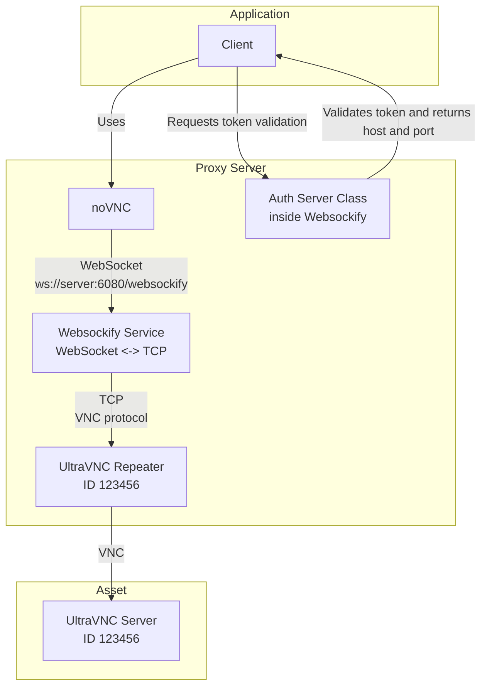
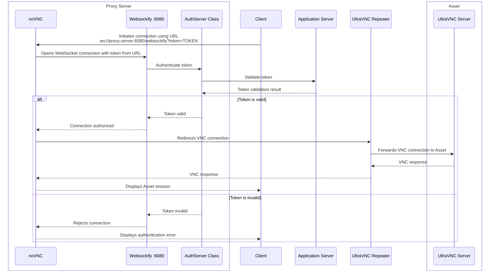

# Websockify and noVNC project for RCMS proxy connection with UVNC Repeater
---
[](https://www.python.org/downloads/)
[](https://github.com/novnc/websockify)
[](https://github.com/novnc/noVNC)


This project implements websockify under python 3, it is an adaptation from the previous version from AD project digitization v1.1

# Installation of RCMS in Ubuntu Server

## Summary
[Installation Instructions](#installation-instructions).

- [Websockify and noVNC project for RCMS proxy connection with UVNC Repeater](#websockify-and-novnc-project-for-rcms-proxy-connection-with-uvnc-repeater)
- [Installation of RCMS in Ubuntu Server](#installation-of-rcms-in-ubuntu-server)
  - [Summary](#summary)
  - [Basic componentes](#basic-componentes)
  - [The source code that will be used for UltraVNC Repeater also is available in `./resources/uvncrepeater.tar.gz`. You can use this file instead of downloading it from the internet if needed.](#the-source-code-that-will-be-used-for-ultravnc-repeater-also-is-available-in-resourcesuvncrepeatertargz-you-can-use-this-file-instead-of-downloading-it-from-the-internet-if-needed)
  - [1. Download the ultravnc server](#1-download-the-ultravnc-server)
  - [2. Install UVNC Repeater](#2-install-uvnc-repeater)
  - [3. Add user for service](#3-add-user-for-service)
  - [4. Execute the service as test](#4-execute-the-service-as-test)
  - [5. Test the repeater manually](#5-test-the-repeater-manually)
  - [6. Create and configure the `uvncrepeater.service` systemd service](#6-create-and-configure-the-uvncrepeaterservice-systemd-service)
    - [Error with the old init.d script](#error-with-the-old-initd-script)
  - [7. Configure persistent systemd journal logs](#7-configure-persistent-systemd-journal-logs)
  - [8. Check the status of the `uvncrepeater` service](#8-check-the-status-of-the-uvncrepeater-service)
  - [9. Check the service logs with `journalctl` and the repeater log file](#9-check-the-service-logs-with-journalctl-and-the-repeater-log-file)
  - [10. Keep the old `init.d` script as a reference and confirm the systemd service file](#10-keep-the-old-initd-script-as-a-reference-and-confirm-the-systemd-service-file)
  - [11. Edit `/etc/uvnc/uvncrepeater.ini` with the RCMS configuration](#11-edit-etcuvncuvncrepeaterini-with-the-rcms-configuration)
  - [12. Install websockify and noVNC](#12-install-websockify-and-novnc)
    - [Create target directory for websockify and noVNC](#create-target-directory-for-websockify-and-novnc)
  - [13. Clone the repositories for websockify and noVNC into the target directory](#13-clone-the-repositories-for-websockify-and-novnc-into-the-target-directory)
    - [Move the source code to the target directory](#move-the-source-code-to-the-target-directory)
      - [For AD Tech team deployment standard:](#for-ad-tech-team-deployment-standard)
  - [15. Install Python dependencies for Python 3](#15-install-python-dependencies-for-python-3)
    - [Install Numpy and requests for Python 3](#install-numpy-and-requests-for-python-3)
  - [16. Create service user](#16-create-service-user)
  - [17. Create systemd service for websockify](#17-create-systemd-service-for-websockify)
  - [14. Configure the token plugin for the 3D app server](#14-configure-the-token-plugin-for-the-3d-app-server)
  - [18. Linux Utilities](#18-linux-utilities)
    - [Configuring proxy](#configuring-proxy)
    - [List Services and Open Ports](#list-services-and-open-ports)
    - [Configs from Ad tech team](#configs-from-ad-tech-team)
    - [Explanation for project adaptation](#explanation-for-project-adaptation)
    - [The source app start the first step to try to connect to remote ultravnc server](#the-source-app-start-the-first-step-to-try-to-connect-to-remote-ultravnc-server)
    - [Executing the sebsockify server](#executing-the-sebsockify-server)
    - [Connection URL to noVNC:](#connection-url-to-novnc)
    - [VNC server for Asset Digitization application](#vnc-server-for-asset-digitization-application)
    - [Sequence diagram for VNC connection through the proxy server](#sequence-diagram-for-vnc-connection-through-the-proxy-server)

---

##  Basic componentes

1. noVNC
2. Websockify
3. UltraVNC Repeater
4. UltraVNC Server

The source code that will be used for UltraVNC Repeater also is available in `./resources/uvncrepeater.tar.gz`. You can use this file instead of downloading it from the internet if needed.
---

## 1. Download the ultravnc server

Create a directory to store the UltraVNC Repeater source code:
```bash
mkdir -p ~/uvnc_repeater_tmp
cd ~/uvnc_repeater_tmp
```

If internet access, try in CLI using the following command to download the UltraVNC Repeater source code whithin the target directory in the server:
```bash
wget http://www.uvnc.eu/download/repeater/uvncrepeater.tar.gz
```

If not internet access is available on the server, you will need to download the UltraVNC Repeater source code on a machine with internet access and then transfer it to the server using ssh session:

To download in a host using web browser, simply navigate to the URL `http://www.uvnc.eu/download/repeater/uvncrepeater.tar.gz` and save the file to a known location. Then use the `scp` command in a power shell or terminal to transfer it to the server.

Also in this repository is hosted the source code for the repeater in the file `./resources/uvncrepeater.tar.gz`.

Execute in powershell next command, take care for the path where you saved the `uvncrepeater.tar.gz` file just downloaded.
```bash
scp /path/to/uvncrepeater.tar.gz user@server:~/uvnc_repeater_tmp
```

## 2. Install UVNC Repeater

Within the directory where the UltraVNC Repeater source code is located, execute the following commands to compile and install it:

```bash
tar -xzf uvncrepeater.tar.gz
cd UVNCRepeater
sudo make
sudo make install
```

Explanation:
- `tar -xzf uvncrepeater.tar.gz` extracts the downloaded tarball.
- `cd UVNCRepeater` navigates into the extracted directory.
- `sudo make` compiles the source code.
- `sudo make install` installs the compiled binaries and configuration files to the appropriate system directories (e.g., `/usr/local/bin` and `/usr/local/lib`).

If ubuntu is minimized version probably you will need to install the build-essential package:
Note: For this step, you need to have internet access on the server to download and install the required packages.
```bash
sudo apt update
sudo apt install build-essential
```

Expected output:
```bash
cp -R repeater /usr/sbin/uvncrepeatersvc
cp -R start-stop-daemon /usr/sbin/start-stop-daemon
cp -R uvncrepeater /etc/init.d/uvncrepeater
cp -R uvncrepeater.ini /etc/uvnc/uvncrepeater.ini
cat message

add user uvncrep with command: "adduser uvncrep -s /bin/false"
```

After installation you can check that the file is in `/usr/sbin/uvncrepeatersvc`.
Check with next command:
```bash
ls /usr/sbin | grep uvnc
```

## 3. Add user for service

Execute in the terminal the following command to add a system user for the UltraVNC Repeater service:
```bash
sudo useradd -r -s /usr/sbin/nologin uvncrep
```

Explanation:
- `sudo useradd -r -s /usr/sbin/nologin uvncrep` adds a system user named `uvncrep` with no login shell and no home directory.
`r` &rarr; Creates a system user (no /home directory, reserved UID < 1000)
`s` &rarr; Assigns a null shell (disables interactive console/SSH login)
uvncrep &rarr; User name

## 4. Execute the service as test

Move to the directory:
```bash
cd /usr/sbin
```

## 5. Test the repeater manually

Execute the following command to test the repeater manually:
```bash
./uvncrepeatersvc
```

If the repeater is running, you should see the following output:

```bash
UltraVnc Linux Repeater version 0.14
UltraVnc Fri Aug 28 21:28:31 2026 > main(): ini file (/etc/uvnc/uvncrepeater.ini) read error, using defaults
UltraVnc Fri Aug 28 21:28:31 2026 > listInitializationValues(): viewerPort : 5900
UltraVnc Fri Aug 28 21:28:31 2026 > listInitializationValues(): serverPort : 5500
UltraVnc Fri Aug 28 21:28:31 2026 > listInitializationValues(): maxSessions: 100
UltraVnc Fri Aug 28 21:28:31 2026 > listInitializationValues(): loggingLevel: 2
UltraVnc Fri Aug 28 21:28:31 2026 > listInitializationValues(): ownIpAddress (0.0.0.0 = listen all interfaces) : 0.0.0.0
UltraVnc Fri Aug 28 21:28:31 2026 > listInitializationValues(): runAsUser (if started as root) : uvncrep
UltraVnc Fri Aug 28 21:28:31 2026 > listInitializationValues(): Mode 1 connections allowed : Yes
UltraVnc Fri Aug 28 21:28:31 2026 > listInitializationValues(): Mode 2 connections allowed : Yes
UltraVnc Fri Aug 28 21:28:31 2026 > listInitializationValues(): Mode 1 allowed server port (0=All) : 0
UltraVnc Fri Aug 28 21:28:31 2026 > listInitializationValues(): Mode 1 requires listed addresses : No
UltraVnc Fri Aug 28 21:28:31 2026 > listInitializationValues(): Mode 2 requires listed ID numbers : No
UltraVnc Fri Aug 28 21:28:31 2026 > listInitializationValues(): useEventInterface: false
UltraVnc Fri Aug 28 21:28:31 2026 > listInitializationValues(): eventListenerHost : localhost
UltraVnc Fri Aug 28 21:28:31 2026 > listInitializationValues(): eventListenerPort : 2002
UltraVnc Fri Aug 28 21:28:31 2026 > listInitializationValues(): useHttpForEventListener : false
UltraVnc Fri Aug 28 21:28:31 2026 > routeConnections(): starting select() loop, terminate with ctrl+c
```

Terminate the repeater with ctrl+c.

```bash
UltraVnc Fri Apr 17 08:36:19 2026 > listInitializationValues(): viewerPort : 5900
UltraVnc Fri Apr 17 08:36:19 2026 > listInitializationValues(): serverPort : 5901
UltraVnc Fri Apr 17 08:36:19 2026 > listInitializationValues(): maxSessions: 100
UltraVnc Fri Apr 17 08:36:19 2026 > listInitializationValues(): loggingLevel: 3
UltraVnc Fri Apr 17 08:36:19 2026 > listInitializationValues(): ownIpAddress (0.0.0.0 = listen all interfaces) : 0.0.0.0
UltraVnc Fri Apr 17 08:36:19 2026 > listInitializationValues(): runAsUser (if started as root) : uvncrep
UltraVnc Fri Apr 17 08:36:19 2026 > listInitializationValues(): Mode 1 connections allowed : No
UltraVnc Fri Apr 17 08:36:19 2026 > listInitializationValues(): Mode 2 connections allowed : Yes
UltraVnc Fri Apr 17 08:36:19 2026 > listInitializationValues(): Mode 1 allowed server port (0=All) : 0
UltraVnc Fri Apr 17 08:36:19 2026 > listInitializationValues(): Mode 1 requires listed addresses : No
UltraVnc Fri Apr 17 08:36:19 2026 > listInitializationValues(): Mode 2 requires listed ID numbers : Yes
UltraVnc Fri Apr 17 08:36:19 2026 > listInitializationValues(): Mode 2 allowed ID list (0=Not allowed): 1001 1002 1003 1004 1005 1006 1007 1008 1009 1010 1011 1012 1013 1014 2014 2015 2016 2017 2037 2038 2039 2040 2041 2042 2043 2044 2045 2046 2049 2050 2051 2052 2053 2054 2090 2091 2092 2093 2137 2138 2143 2144 2145 2146 2318 2319 2323 2324 2325 2326 2327 2328 2329 2330 2905 2906 2914 2918 2919 2921 2923 2925 0 0 0 0 0 0 0 0 0 0 0 0 0 0 0 0 0 0 0 0 0 0 0 0 0 0 0 0 0 0 0 0 0 0 0 0 0 0
UltraVnc Fri Apr 17 08:36:19 2026 > listInitializationValues(): useEventInterface: false
UltraVnc Fri Apr 17 08:36:19 2026 > listInitializationValues(): eventListenerHost : localhost
UltraVnc Fri Apr 17 08:36:19 2026 > listInitializationValues(): eventListenerPort : 2002
UltraVnc Fri Apr 17 08:36:19 2026 > listInitializationValues(): useHttpForEventListener : true
UltraVnc Fri Apr 17 08:36:19 2026 > startListeningOnPort(): socket() initialized
UltraVnc Fri Apr 17 08:36:19 2026 > startListeningOnPort(): setsockopt() success
UltraVnc Fri Apr 17 08:36:19 2026 > startListeningOnPort(): bind() to (ip: 0.0.0.0, port: 5900) succeeded
UltraVnc Fri Apr 17 08:36:19 2026 > startListeningOnPort(): listen() succeeded
UltraVnc Fri Apr 17 08:36:19 2026 > startListeningOnPort(): socket() initialized
UltraVnc Fri Apr 17 08:36:19 2026 > startListeningOnPort(): setsockopt() success
UltraVnc Fri Apr 17 08:36:19 2026 > startListeningOnPort(): bind() to (ip: 0.0.0.0, port: 5901) succeeded
UltraVnc Fri Apr 17 08:36:19 2026 > startListeningOnPort(): listen() succeeded
UltraVnc Fri Apr 17 08:36:19 2026 > routeConnections(): starting select() loop, terminate with ctrl+c
```

## 6. Create and configure the `uvncrepeater.service` systemd service


If not installed nano, you can install it using the following command:
```bash
sudo apt-get install nano
```
### Error with the old init.d script

The script of init.d is a classic script used before systemd, this is pre-systemd (SysVinit or compatible)
To avoid error with the old init.d script, you should check if it exists and remove it before starting the service with systemd.

Check if the old init.d script exists:
```bash
ls /etc/init.d/uvncrepeater
```

If the old init.d script exists, it is recommended to remove it to prevent conflicts with the systemd service.
Remove the old script to avoid errors when starting the service with systemd. This ensures that the systemd service will be the primary method for managing the UltraVNC Repeater.
```bash
sudo rm /etc/init.d/uvncrepeater
```

Create the service file:
```bash
sudo nano /etc/systemd/system/uvncrepeater.service
```

Copy and paste the following content into the `uvncrepeater.service` file.

Next is the content needed for the `uvncrepeater.service` systemd service file.
It is an adaptation of the old init.d script for use with systemd.
Content for the service file (Translation from init.d to systemd):

```ini
[Unit]
Description=UltraVNC Repeater
After=network.target

[Service]
Type=simple
ExecStart=/usr/sbin/uvncrepeatersvc /etc/uvnc/uvncrepeater.ini
Restart=on-failure
RestartSec=3

# User for running the service, this is the same user created for the init.d script
User=uvncrep
Group=uvncrep

# Logs (systemd handles this, but if you want a file as well:)
StandardOutput=append:/var/log/uvncrepeater.log
StandardError=append:/var/log/uvncrepeater.log

[Install]
WantedBy=multi-user.target
```

Save with `ctrl+o` and exit with `ctrl+x`.

Notes:
Every time after changes in service config restart the service:

```bash
sudo systemctl daemon-reload
sudo systemctl enable uvncrepeater
sudo systemctl restart uvncrepeater
```

## 7. Configure persistent systemd journal logs

Enter in the configuration file for the systemd journal:
```bash
sudo nano /etc/systemd/journald.conf
```

Uncomment the following lines to configure the journal logs:
```ini
[Journal]
Storage=persistent
SystemMaxUse=200M
SystemKeepFree=100M
MaxRetentionSec=7day
Compress=yes
RateLimitIntervalSec=30s
RateLimitBurst=1000
```

Give ctrl+o to save the file and ctrl+x to exit the editor.

Restart the journal
```bash
sudo systemctl restart systemd-journald
```

Restart the systemd daemon to recognize the new service:
```bash
sudo systemctl daemon-reload
```
Enable and start the uvncrepeater service

```bash
sudo systemctl enable uvncrepeater
sudo systemctl start uvncrepeater
```

## 8. Check the status of the `uvncrepeater` service

Ensure the service is running by checking its status:
```bash
sudo systemctl status uvncrepeater
```

The exepected output should show that the uvncrepeater service is active and running, ignore the srvubu115 hostname, this was a development server.

```bash
● uvncrepeater.service - UltraVNC Repeater
     Loaded: loaded (/etc/systemd/system/uvncrepeater.service; enabled; preset: enabled)
     Active: active (running) since Fri 2026-08-28 21:50:23 UTC; 1min 11s ago
   Main PID: 2620 (uvncrepeatersvc)
      Tasks: 1 (limit: 18792)
     Memory: 304.0K (peak: 424.0K)
        CPU: 6ms
     CGroup: /system.slice/uvncrepeater.service
             └─2620 /usr/sbin/uvncrepeatersvc /etc/uvnc/uvncrepeater.ini

Aug 28 21:50:23 srvubu115 systemd[1]: Started uvncrepeater.service - UltraVNC Repeater.
```

The status is active (running) as shown in the output above in green.

## 9. Check the service logs with `journalctl` and the repeater log file

To view the logs of the uvncrepeater service, you can use the `journalctl` command:

```bash
sudo journalctl -u uvncrepeater -f
```
Give permissions to the ini file, and log file to the user uvncrep:

```bash
sudo chown uvncrep:uvncrep /etc/uvnc/uvncrepeater.ini
sudo chown uvncrep:uvncrep /var/log/uvncrepeater.log
```

Take account, when you need to make troubleshooting, you nwil need to give a look in the log file:
```bash
cat /var/log/uvncrepeater.log
```
## 10. Keep the old `init.d` script as a reference and confirm the systemd service file
script de init.d (for reference)
```bash
#!/bin/sh
#!/bin/sh

PATH=/sbin:/bin
UVNCREPPID=/var/run/uvncrepeater.pid
UVNCREPLOG=/var/log/uvncrepeater.log
UVNCREPRUN=/usr/sbin/uvncrepeater-log
UVNCREPSVC=/usr/sbin/uvncrepeatersvc
UVNCREPINI=/etc/uvnc/uvncrepeater.ini

#if service file does not exist then exit the script

if test ! -x $UVNCREPSVC ; then
  echo $UVNCREPSVC file was not found.
  echo Exiting...
  exit 2
fi

#Create the file to start the service if it does not exist

if test ! -x $UVNCREPRUN ; then
  echo '#!/bin/sh' > $UVNCREPRUN
#    echo 'exec' $UVNCREPSVC '2>>' $UVNCREPLOG  >> $UVNCREPRUN
  echo 'exec' $UVNCREPSVC $UVNCREPINI '2>>' $UVNCREPLOG  >> $UVNCREPRUN
  chmod +x $UVNCREPRUN
fi

case "$1" in
start)
  echo -n "Running UltraVNC Repeater..."
  /usr/sbin/start-stop-daemon --start -b -m -p $UVNCREPPID --exec $UVNCREPRUN -- $UVNCREPLOG
  echo "."
  ;;
stop)
  echo  "Stopping UltraVNC Repeater..."
  /usr/sbin/start-stop-daemon --stop -p $UVNCREPPID
  rm $UVNCREPPID
  ;;
*)
  echo "Usage: $0 {start|stop}"
  exit 1
esac
exit 0
```

Confirm that the service exists in:

```bash
ls /etc/systemd/system/uvncrepeater.service
```


## 11. Edit `/etc/uvnc/uvncrepeater.ini` with the RCMS configuration

Move to the directory:
```bash
cd /etc/uvnc
```

Rename file from the original to make a backup:
```bash
sudo mv uvncrepeater.ini uvncrepeater_old.ini
```

Modify the file with the content configured for RCMS, save file.
```bash
sudo nano uvncrepeater.ini
```

Put in the `uvncrepeater.ini` a configuration suitable for the RCMS setup.
Can be used next:
locates in: `./uvncrep_ini/uvncrepeater.ini` in relative path of this repository.


Restart the uvncrepeater service to apply the changes:
```bash
sudo systemctl restart uvncrepeater
```

Check the status of the uvncrepeater service to ensure it is running correctly:
```bash
sudo systemctl status uvncrepeater
```

## 12. Install websockify and noVNC

The installation for the proxy service consist in noVNC and websockify.

Websockify is written in python and requires Python 3.6 or higher to run. Ensure that your system has the appropriate version of Python installed before proceeding with the installation.

Normally Ubuntu Server 24.04 LTS (Noble Numbat) comes with Python 3.12 pre-installed.

Check the Python version installed on your system:
```bash
python3 --version
```
In case the Python version is lower than 3.6, you will need to install a compatible version of Python before proceeding with the installation of websockify and noVNC.

Install new version of Python if necessary, internet connection is required to reach ubuntu repositories:
```bash
sudo apt update
sudo apt install python3.12
```

### Create target directory for websockify and noVNC

```bash
sudo mkdir -p /opt/adwebsockify
```

Move to the target directory:
```bash
cd /opt/adwebsockify
```
Assign permissions of the target directory to the `adp` user and group to allow proper access.
```bash
sudo chown -R adp:adp /opt/adwebsockify
```

## 13. Clone the repositories for websockify and noVNC into the target directory

### Move the source code to the target directory

#### For AD Tech team deployment standard:

It involves to freeze all source code withing a zip file and labeled with a version control, with this 
method, will be required to download the zip file and copy in a temporary directory in the ubuntu server.
The curent package for websockify/noVNC is given in the respository same with this guide. Ensure that the zip file is extracted into a temporary directory before moving it to the target directory.

`Until this release the version for the zip deployment artifact is v2.0.`

Copy the zip deployment file to the temporary directory, for example `/proxy_tmp`.
```bash
sudo mkdir -p ~/proxy_tmp
```

Use powershell in in the windows host to copy the zip file to the temporary directory `/proxy_tmp` on the Ubuntu server. For example:
```powershell
scp "C:\path\to\v2.0.zip" <username>@<ubuntu_server_ip>:~/proxy_tmp/
```
Check listing the files if the zip file has been successfully copied:
```bash
ls ~/proxy_tmp
```
Perform unzip the source code into `/opt/adwebsockify` directory, for example:
```bash
unzip ~/proxy_tmp/v2.0.zip -d /opt/adwebsockify
```

This is important, because the services that we will install later depend on the files being correctly placed in the target directory, in special in the path `/opt/adwebsockify`, this place is the best practice for deployment in Ubuntu servers and ensure a different location form the user home directory.

Notes: If unzip is not installed on your system, you can install it using the following command:
```bash
sudo apt update
sudo apt install unzip
```

## 15. Install Python dependencies for Python 3

### Install Numpy and requests for Python 3
In case the current Ubuntu Python 3 installation does not include the `numpy`  and `requests` library by default, you can install it using the following commands:

```bash
sudo apt update
sudo apt install python3-numpy python3-requests
```

Check Python dependencies:
```bash
python3 -c "import numpy, requests; print('Python dependencies OK')"
```

## 16. Create service user

Create a dedicated user for running the Websockify service:
```bash
sudo useradd \
    --system \
    --no-create-home \
    --shell /usr/sbin/nologin \
    websockify
```

Add the current user to the websockify group:
```bash
sudo usermod -aG websockify "$USER"
```

Log out and log back in for the group changes to take effect, close ssh sessions and reconnect.

Grant group access to the Websockify/noVNC installation directory:
```bash
sudo chown -R root:websockify /opt/adwebsockify
sudo chmod -R g+rwX /opt/adwebsockify
sudo find /opt/adwebsockify -type d -exec chmod g+s {} \;
```
Explanation:
The commands above change the ownership of the `/opt/adwebsockify` directory to the `root` user and the `websockify` group, grant read, write, and execute permissions to the group, and set the setgid bit on all directories to ensure that new files and directories inherit the group ownership.

## 17. Create systemd service for websockify

Create a systemd service file for websockify:
```bash
sudo nano /etc/systemd/system/websockify.service
```

Add the following content to the file:
```ini
[Unit]
Description=Websockify noVNC Proxy
After=network.target

[Service]
Type=simple

User=websockify
Group=websockify

WorkingDirectory=/opt/adwebsockify/websockify_ad/Websockify

ExecStart=/opt/adwebsockify/Websockify/run --web /opt/adwebsockify/noVNC --token-plugin AuthServer 6080

Restart=always
RestartSec=3

[Install]
WantedBy=multi-user.target
```

Save with `Ctrl+O` and exit with `Ctrl+X`.

Put attention in the `ExecStart` line, ensuring that the path to the `run` script and the `--web` and `--token-plugin` options are correctly specified.

`/opt/adwebsockify/Websockify/run`: This is the main executable script for Websockify, responsible for starting the Websockify server with the specified options. Ensure that this path matches the actual location of the `run` script in your installation in `/opt/adwebsockify/Websockify`.
`--web`: This option specifies the path to the web content that will be served by Websockify, typically pointing to the noVNC directory. In this case, it is set to `/opt/adwebsockify/noVNC`.
`--token-plugin`: This option specifies the authentication plugin to be used by Websockify. In this case, it is set to `AuthServer`, which should correspond to the AD customization implemented for authentication, later explained in the documentation.

Reload systemd to apply the changes:
```bash
sudo systemctl daemon-reload
sudo systemctl enable websockify
sudo systemctl start websockify
```

Check status:
```bash
sudo systemctl status websockify
```

Check logs with journalctl:
```bash
journalctl -u websockify -f
```

Path directory references:

```
/opt        → application installed
/etc        → configuration
/var/lib    → persistent data
/var/log    → logs
/etc/systemd/system → service
```

## 14. Configure the token plugin for the 3D app server
TODO: Complement the path for configuration

In the file `token_plugins.py`
Located in:
```bash
cd /opt/adwebsockify/websockify_ad/Websockify/websockify
```

Open the file and configure the token plugin according to the requirements of the 3D app server. Save the changes after editing.

```bash
cd /opt/adwebsockify/websockify_ad/Websockify/websockify
sudo nano token_plugins.py
```

```python
import os
import sys
import time
import re
import logging
import requests
logger = logging.getLogger("TokenPlugin")
logging.basicConfig(level=logging.INFO)

# Define the application ip and port to where request token validation
adpapp = ('192.168.10.101', 1088)
# Define the repeater ip and port to where the validated token will connect
repeater = ('localhost', 5900)
# Define the URL path for token validation in the Asset Digitization application
url = "/ahm/cms_validation.json"
# url = "/system/webdev/uvnc_dev/dev/token_validation"


class AuthServer():
    """Token plugin that validates tokens by making a request to the Asset Digitization application."""
```

Set:
`adpapp` = ('192.168.10.101', 1088) -> The ip and port for the 3D app server, usually port is 80

Ctrl+O to save the file and Ctrl+X to exit the editor.

## 18. Linux Utilities

### Configuring proxy

To configure a proxy for the user to allow apt update or installation of packages, you can set the `http_proxy` and `https_proxy` environment variables. For example:

```bash
export http_proxy="http://your-proxy-server:port"
export https_proxy="http://your-proxy-server:port"
```

### List Services and Open Ports
List services:
```bash
systemctl list-units --type=service 
```

Look for only a specific service:
```bash
systemctl list-units --type=service | grep uvncrepeater
```

List open ports:
```bash
ss -tulnp
```

### Configs from Ad tech team

Configuration for the service, only as reference

```ini
[Unit]
Description=websockify.proxy
After=syslog.target network.target

[Service]
Type=simple
ExecStart=/usr/local/bin/websockify 6080 localhost:5900

PIDFile=/home/student/.vnc/%H%i.pid
ExecStop=/bin/sh -c '/usr/bin/killall websockify'
KillMode=process
Restart=on-failure
User=root
Group=root

[Install]
WantedBy=multi-user.target
```
---

scale: (true) was added in order to allow the noVNC client to automatically scale the remote desktop to fit the browser window.

### Explanation for project adaptation

1. Modify Auth class for token plugin, use python 3 library `requests`
2. Modify the function `closed` to use `requests` library


### The source app start the first step to try to connect to remote ultravnc server

The first step is triggered by the source app, in the version v1.1 this source app is the 3xs AD app, the trigger is located in a button that execute the process of create a session id and token, then perform a request to the url on the proxy or the built-in 3xs server, this requets is to noVNC hmtl client entry point, the url is like this:

```
http://<proxy_or_3xs_server>/remote.html?adp=<token>
```

```
http://10.11.54.40:6080/remote.html?&adp=9ad2904a-482a-43ed-8787-18f136be3323&repeaterID=1006&autoconnect=true&resize=scale&shared=true&reconnect=true&reconnect_delay=5000
```

The noVNC client redirect the request to the websockify server with the token, then the websockify server validate the token performing a request to the source app, in this case the 3xs AD app, in the url:

```
http://<ad_app>:80/ahm/cms_validation.json?adp=<token>
```

The adp app validate the token and return:

```json
{
    "validation": true,
    "id": some data,
}
```

The filed validation is true if the token is valid

If the validation is different of true, the websockify server call a functiion `closed` by sendign an id parameter (thus semas to be a random id) and a status filed with string in 0

```python
# Envia el evento de cierre de la conexion al servidor del Asset Digitization
def closed(self, id, status):
    connection = httplib.HTTPConnection(adpapp[0], adpapp[1])
    connection.request("GET", url+"?id="+str(id)+"&status="+str(status))
    response = connection.getresponse()
    connection.close()
```

When the validation is true the websockify server return the repeater ip and port to upgrade the connection to websocket and start the communication with the remote ultravnc server using the repeater.

### Executing the sebsockify server

The version v1.1 run the proxy with the command:

```bash
#!/bin/bash
nohup /usr/local/adpgcc/Version1.1/websockify-master/run \
--web="/usr/local/adpgcc/Version1.1/noVNC-master" \
--token-plugin=AuthServer 6080 >> /var/log/adremote.log &
```

> [!TIP] No hang up, run the programmin background even if terminal windows is closed.

In the line `--token-plugin=AuthServer 6080 >> /var/log/adremote.log &`, AuthServer is the name of the class within the module `token_plugins.py`, by this the logic previously described is implemented, the port 6080 is the port where the websockify server will listen for incoming connections.

Whithin the file `run`:

```bash
#!/usr/bin/env sh
set -e
cd "$(dirname "$0")"
exec python -m websockify "$@"
```

Explanation:
- `#!/usr/bin/env sh`: Especifica que el script debe ejecutarse con el intérprete de comandos `sh`.
- `set -e`: Hace que el script se detenga si cualquier comando devuelve un error.
- `cd "$(dirname "$0")"`: Cambia el directorio de trabajo al directorio donde se encuentra el script, asegurando que los comandos posteriores se ejecuten en el contexto correcto.
- `exec python -m websockify "$@"`: Ejecuta el módulo `websockify` con cualquier argumento que se le haya pasado al script, reemplazando el proceso actual del script con el proceso de Python. Esto es útil para asegurar que el script se ejecute correctamente y que cualquier argumento se pase al módulo `websockify` sin necesidad de manejar manualmente los argumentos dentro del script.

### Connection URL to noVNC:
Connection URL to noVNC:

`http://192.168.10.115:6080/remote.html?&adp=9ad2904a-482a-43ed-8787-18f136be3323&repeaterID=1001&autoconnect=true&resize=scale&shared=true&reconnect=true&reconnect_delay=5000&scale=true`

### VNC server for Asset Digitization application




### Sequence diagram for VNC connection through the proxy server
